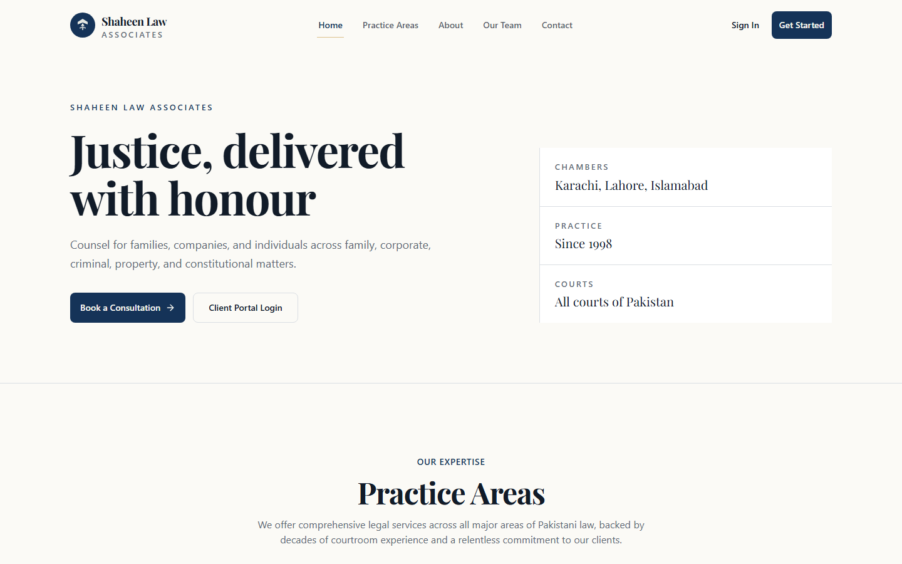
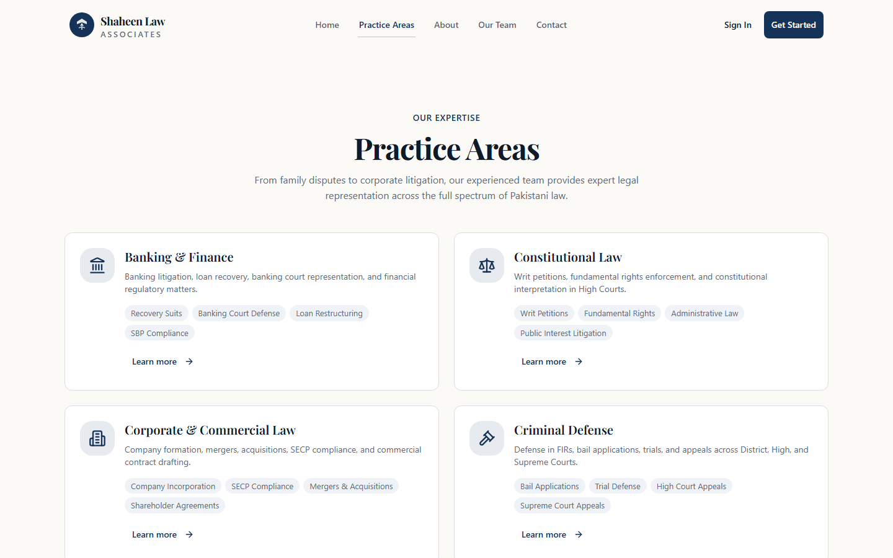
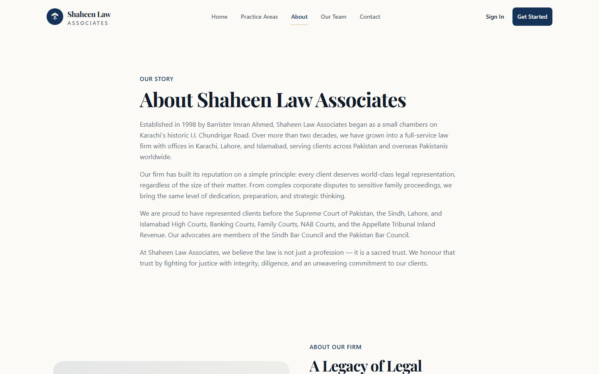
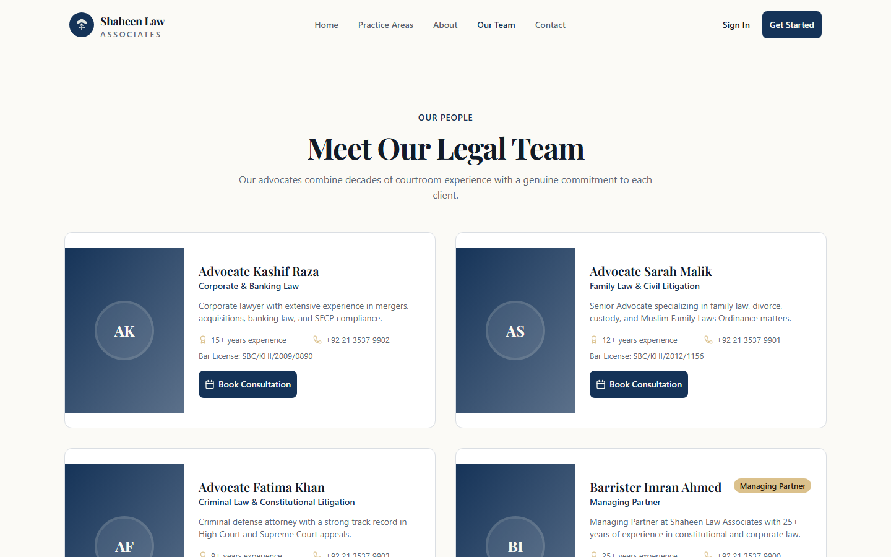
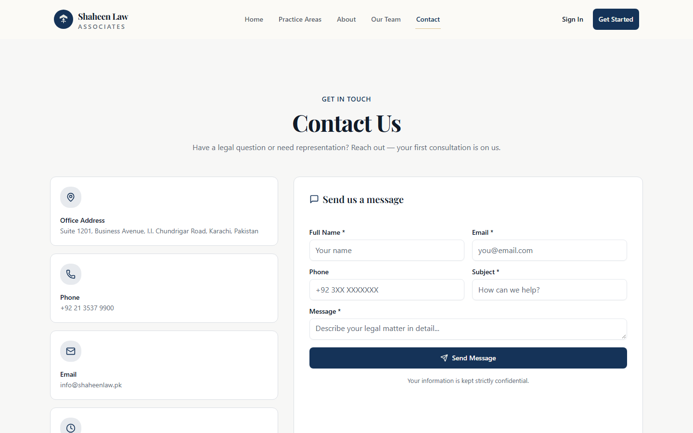
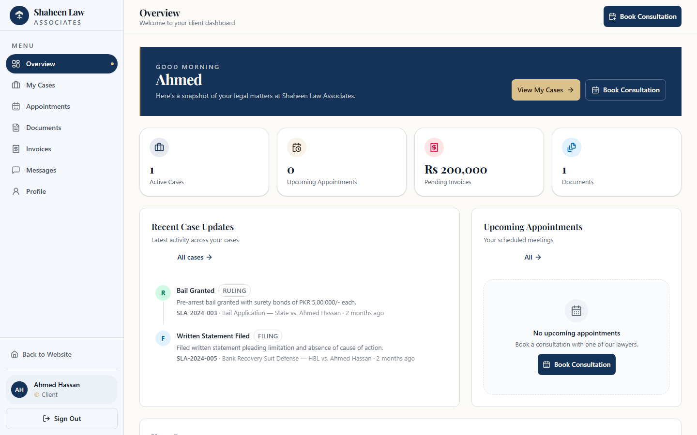
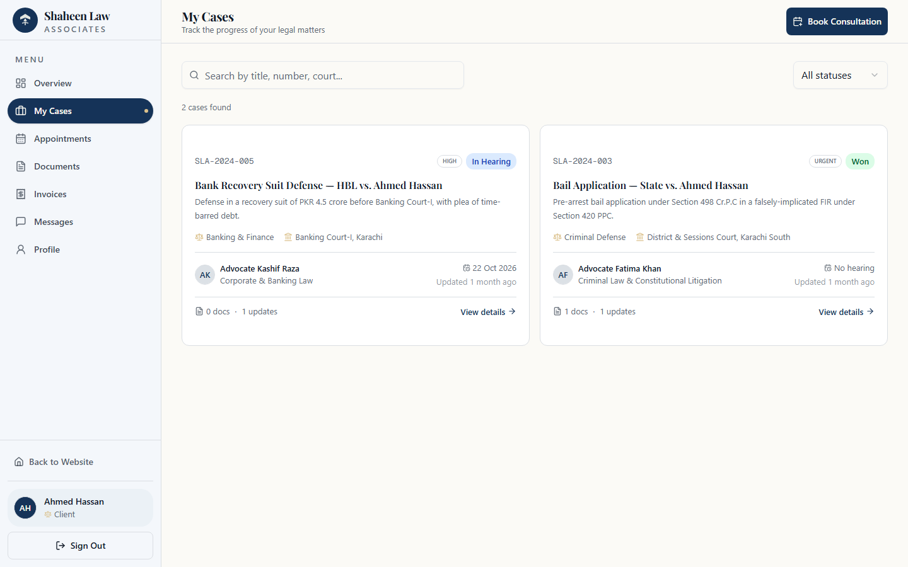
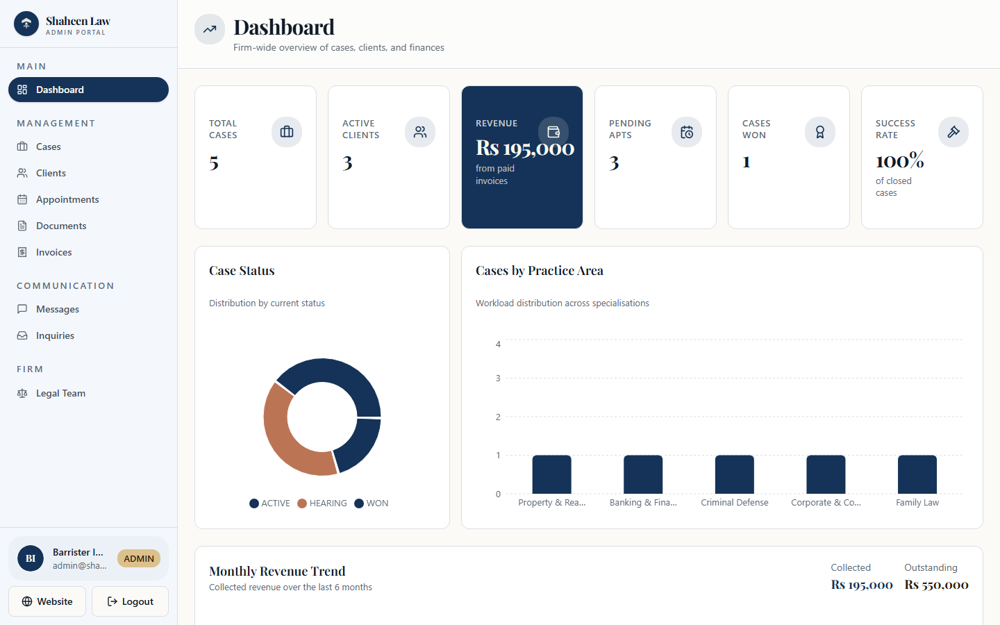

<div align="center">

# ⚖️ Shaheen Law Associates

**A practice-management demo for a Pakistani law firm — public site, client portal and staff dashboard in one app.**

[](https://github.com/Salar11111/LawFirm-01/actions/workflows/ci.yml)


</div>

---

## ✨ Why Shaheen?

Most law-firm sites stop at a brochure. This one carries the whole client journey: a visitor reads about the chambers and books a consultation, a client signs in to follow their own matters and invoices, and the staff work from a dashboard that tracks cases, hearings, revenue and workload by practice area.

The demo is deliberately scoped to one firm with invented matters and clients. Roles are simple — `ADMIN`, `LAWYER` and `CLIENT` — and enforced in the right places: advocates only see assigned matters, clients only see their own, and administrators see everything. It runs on SQLite with a seeded database checked into the repo, so it starts in seconds.

### 🧩 What's inside

- 🌐 **Public site** — practice areas, the firm's story, the advocates, contact and consultation booking.
- 🔐 **Client portal** (`/portal`) — clients see only their own cases, appointments, documents, invoices and messages.
- 📊 **Staff dashboard** (`/dashboard`) — firm-wide cases, revenue, hearings and workload, with charts for status, practice mix and collected revenue.
- 💬 **Messages and notices** — hearings, invoices and messages create an in-app notice, and an email when `RESEND_API_KEY` is set.
- 🔑 **Signed sessions** — HMAC-signed cookie, scrypt password hashes and a double-submit CSRF token.
- 📎 **Private uploads** — files go to `storage/uploads` and download through an authenticated route that checks role and matter.

Sign-in is a dialog: clients land on `/portal`, staff on `/dashboard`.

---

## 📸 Screenshots

The seeded demo, captured at 1440×900.

| Home | Practice areas | About |
| --- | --- | --- |
|  |  |  |

| Team | Contact | Client portal |
| --- | --- | --- |
|  |  |  |

| Client cases | Staff dashboard |
| --- | --- |
|  |  |

---

## 🚀 Quick start

You need [Bun](https://bun.sh/) (or Node.js 20+) and a checkout of this repository. The seeded database is already in `db/custom.db`.

Create `.env` in the project root:

```env
DATABASE_URL="file:../db/custom.db"
AUTH_SECRET="replace-with-a-long-random-string"
```

`DATABASE_URL` resolves from `prisma/`, so that path points at `db/custom.db`. `AUTH_SECRET` signs session cookies and is required in production (development falls back to a built-in value).

```bash
bun install
bunx prisma generate
bun run dev
```

Open [http://localhost:3000](http://localhost:3000). `bun run dev` starts on port 3000 in PowerShell, Git Bash, macOS and Linux.

### Rebuild the demo data

This wipes and rewrites the SQLite file, then reloads the firm, matters, invoices and accounts from `prisma/seed.ts`.

```bash
bunx prisma db push
bunx tsx --env-file=.env prisma/seed.ts
```

### Demo accounts

Every password comes from the seed. New passwords need at least eight characters, including a letter and a number. Change these accounts before any public deployment. Signing out revokes that account's other sessions; without `RESEND_API_KEY` and `MAIL_FROM` the reset link is shown in the demo instead of emailed.

| Role | Name | Email | Password |
| --- | --- | --- | --- |
| Administrator | Barrister Imran Ahmed | `admin@shaheenlaw.pk` | `admin123` |
| Advocate | Advocate Sarah Malik | `sarah@shaheenlaw.pk` | `lawyer123` |
| Advocate | Advocate Kashif Raza | `kashif@shaheenlaw.pk` | `lawyer123` |
| Advocate | Advocate Fatima Khan | `fatima@shaheenlaw.pk` | `lawyer123` |
| Client | Ahmed Hassan | `ahmed.client@email.com` | `client123` |
| Client | Sana Tariq | `sana.client@email.com` | `client123` |
| Client | Usman Sheikh | `usman.client@email.com` | `client123` |

---

## 🧱 Stack

| Layer | Choice |
| --- | --- |
| Framework | Next.js 16 App Router, React 19 |
| Styling | Tailwind CSS 4, shadcn/ui |
| Database | Prisma 6 + SQLite (`db/custom.db`) |
| Validation / state | Zod, Zustand |
| Auth | HMAC-signed cookie, scrypt hashes, double-submit CSRF |
| Tests | Node test runner |

---

## 🗺 Routes

| URL | Who |
| --- | --- |
| `/`, `/practice-areas`, `/about`, `/team`, `/contact` | Public |
| `/portal` and `/portal/cases`, `/appointments`, `/documents`, `/invoices`, `/messages`, `/profile` | Clients |
| `/dashboard` and `/dashboard/cases`, `/clients`, `/appointments`, `/documents`, `/invoices`, `/messages`, `/inquiries`, `/team` | Administrators and advocates |

`/api/practice-areas`, `/api/team`, `/api/reviews`, `/api/stats`, `/api/csrf`, `/api/auth/*` and `POST /api/contact` are public. Every other API route requires a session.

---

## 🗂 Project layout

```text
src/app/(site)        Public pages
src/app/portal        Client portal
src/app/dashboard     Staff dashboard
src/app/api           Route handlers
src/components        Public pages, both portals, shared UI
src/lib               Auth, database, validation, services
prisma/schema.prisma  SQLite schema
prisma/seed.ts        Demo firm
db/custom.db          Seeded database
storage/uploads       Private uploads (not committed)
tests                 Node test runner
docs/screenshots      Images in this README
```

---

## ✅ Tests & scripts

| Command | What it does |
| --- | --- |
| `bun run dev` | Development server on port 3000 |
| `bun run test` | Access, password, session and upload tests |
| `bun run lint` | ESLint |
| `bun run db:generate` | `prisma generate` |
| `bun run db:push` | Push the schema to SQLite |
| `bun run build` | Production build with static assets copied into standalone output |
| `bun run start` | Run the standalone server |

---

## 🚢 Deployment notes

This is a demo of one chambers with invented data. It runs on SQLite and stores login and contact limits in the database so they survive a restart of this single server. A production deployment would want Postgres, a real `AUTH_SECRET`, HTTPS, and a review of those limits before running more than one server.

---

## 🗺 Roadmap ideas

- 🗄️ Move to Postgres for multi-server deployments
- 📅 Hearing calendar with reminders
- 📤 Document sharing links with expiry
- 🔍 Search across matters, clients and invoices

---

<div align="center">

Justice, delivered with honour — and with role checks on every route.

</div>
