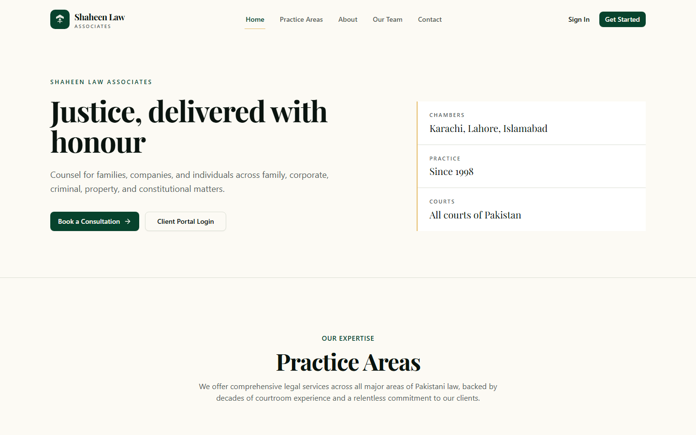
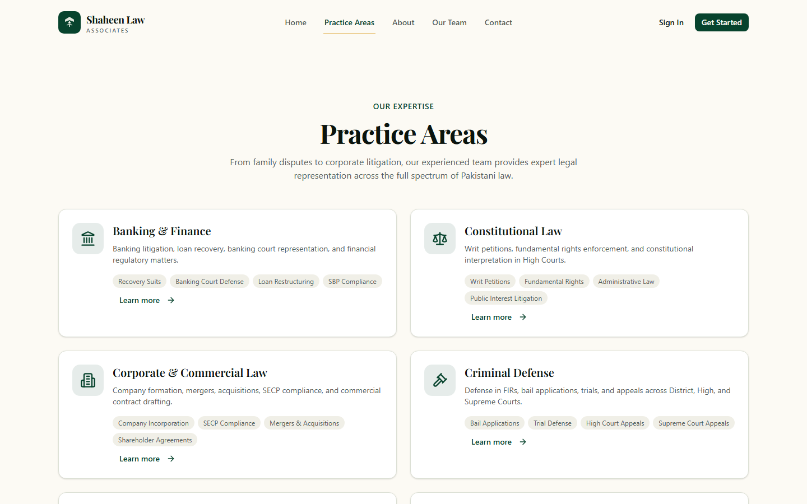
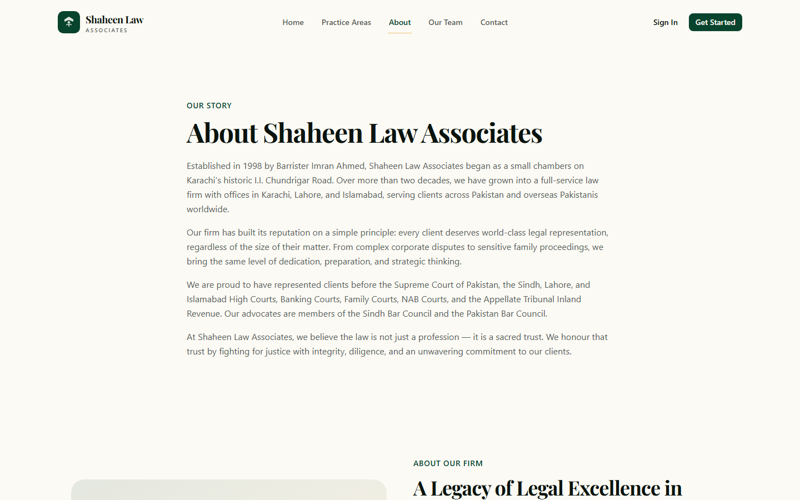
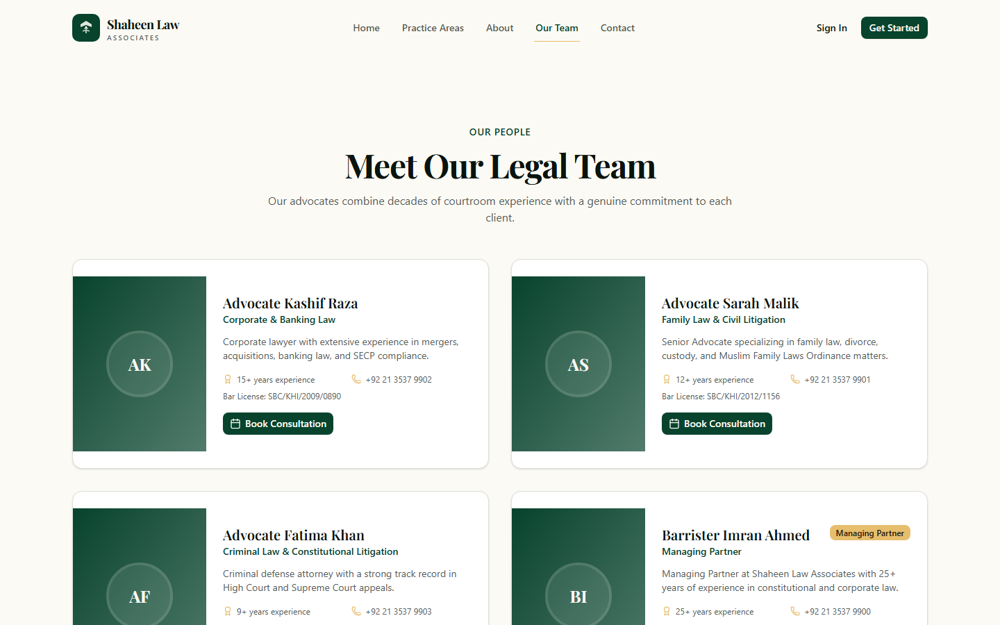
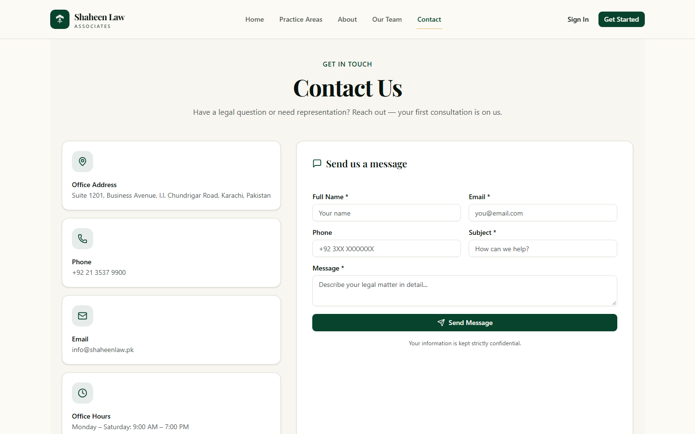
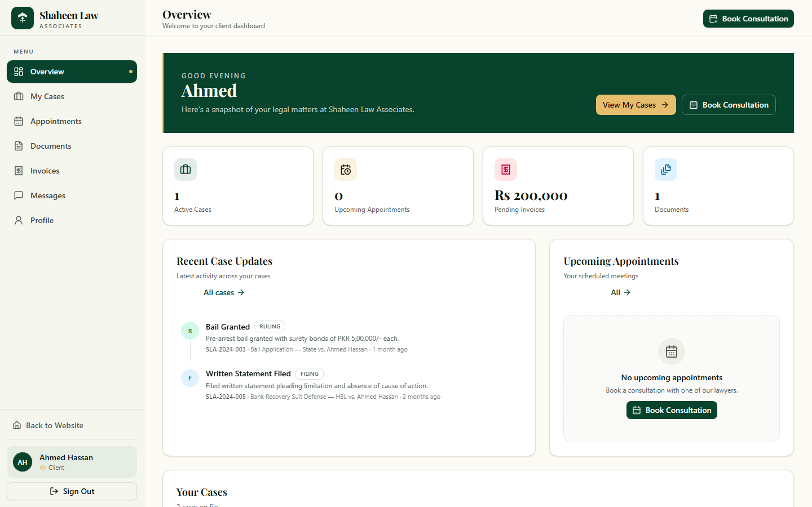
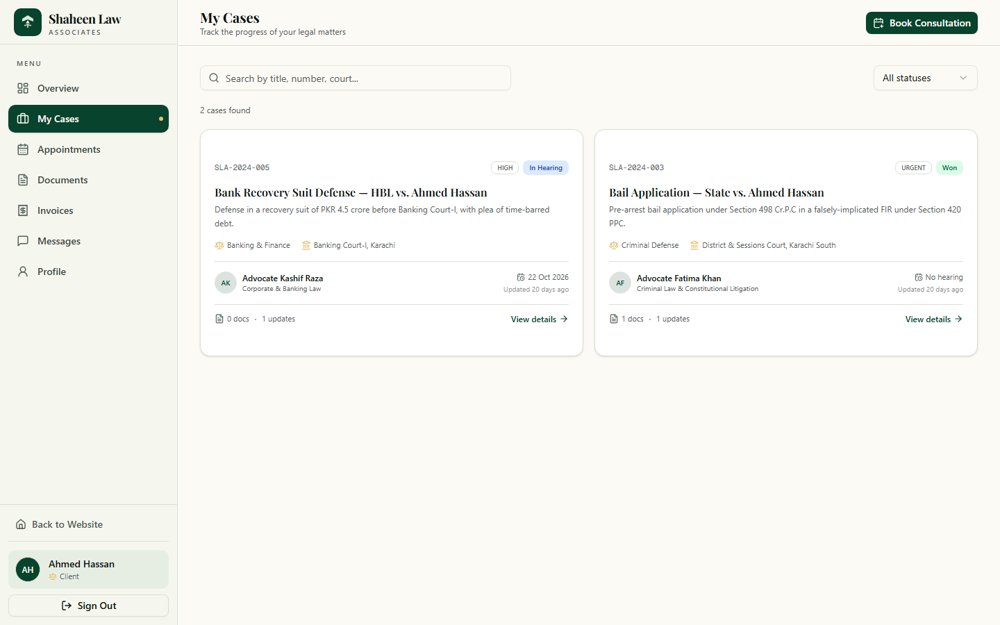
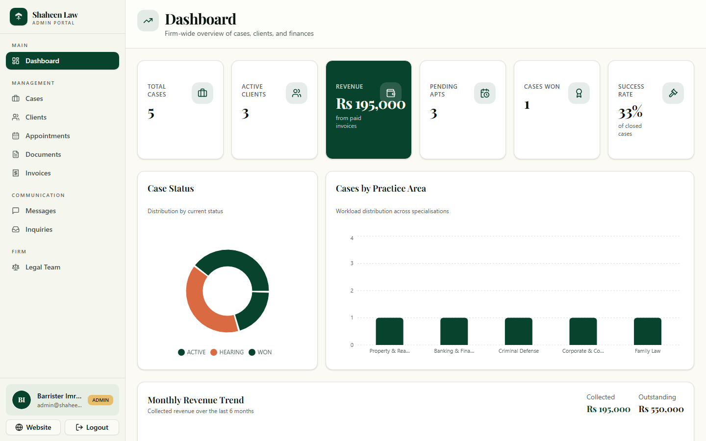

# Shaheen Law Associates

A practice-management demo for a Pakistani law firm. The public site introduces the chambers. Clients follow their own matters in a portal. Partners and advocates run the firm from a staff dashboard.

The screenshots below are the seeded demo, captured at 1440×900.

## Screenshots

### Public site

Home. Consultation booking, client login, and the chambers in Karachi, Lahore, and Islamabad.



Practice areas, from banking and constitutional work through criminal defence.



The firm’s story, from chambers on I.I. Chundrigar Road in 1998.



The advocates, with practice, experience, and bar licence.



Confidential enquiries. The first consultation is offered on the form.



### Client portal

Ahmed Hassan’s overview: open matters, hearings, invoices, and recent rulings.



His two matters, including a banking recovery and a bail application.



### Staff dashboard

Firm-wide cases, revenue, hearings, and workload by practice.



## What you can do

**Public site.** Read the practice areas, the firm’s story, and the team. Book a consultation or send a confidential enquiry. Sign in from the header.

**Client portal** (`/portal`). A client sees only their own cases, appointments, documents, invoices, and messages, and can update their profile.

**Staff dashboard** (`/dashboard`). Administrators and assigned advocates manage cases, clients, appointments, documents, invoices, messages, enquiries, and the legal team. The home view charts status, practice mix, and collected revenue.

Sign-in is a dialog. After a successful login, clients land on `/portal` and staff land on `/dashboard`.

## Stack

- [Next.js 16](https://nextjs.org/) App Router and React 19
- Tailwind CSS 4 and shadcn/ui
- Prisma 6 with SQLite (`db/custom.db`)
- Zod validation, Zustand for client session state
- HMAC-signed session cookie, scrypt password hashes, and a double-submit CSRF token

Uploaded files are written to `storage/uploads` (gitignored) and are not served as public static files. Download goes through an authenticated route that checks the caller’s role and matter.

## Getting started

You need [Bun](https://bun.sh/) (or Node.js 20+) and a checkout of this repository. The seeded database is already in `db/custom.db`.

Create `.env` in the project root:

```env
DATABASE_URL="file:../db/custom.db"
AUTH_SECRET="replace-with-a-long-random-string"
```

`DATABASE_URL` is resolved from the `prisma/` directory, so that path points at `db/custom.db`. `AUTH_SECRET` signs session cookies. It is required in production. In development, an unset secret falls back to a built-in value, so set one if you want sessions to survive a change of environment.

Install dependencies, generate the Prisma client, and start the app:

```bash
bun install
bunx prisma generate
bunx next dev -p 3000
```

Open [http://localhost:3000](http://localhost:3000).

The `dev`, `build`, and `start` scripts in `package.json` use Unix shell syntax (`NODE_OPTIONS=…`, `tee`, `cp`). On Windows PowerShell, run the commands above directly. In Git Bash, macOS, or Linux, `bun run dev` works as written.

### Rebuild the demo data

This wipes and rewrites the SQLite file, then loads the firm, matters, invoices, and accounts from `prisma/seed.ts`.

```bash
bunx prisma db push
bunx tsx --env-file=.env prisma/seed.ts
```

## Demo accounts

Every password below comes from the seed. Use them only on this demo.

| Role | Name | Email | Password |
| --- | --- | --- | --- |
| Administrator | Barrister Imran Ahmed | `admin@shaheenlaw.pk` | `admin123` |
| Advocate | Advocate Sarah Malik | `sarah@shaheenlaw.pk` | `lawyer123` |
| Advocate | Advocate Kashif Raza | `kashif@shaheenlaw.pk` | `lawyer123` |
| Advocate | Advocate Fatima Khan | `fatima@shaheenlaw.pk` | `lawyer123` |
| Client | Ahmed Hassan | `ahmed.client@email.com` | `client123` |
| Client | Sana Tariq | `sana.client@email.com` | `client123` |
| Client | Usman Sheikh | `usman.client@email.com` | `client123` |

Advocates only see matters assigned to them. Clients only see their own. Administrators see the whole firm.

## Routes

| URL | Who |
| --- | --- |
| `/` | Public home |
| `/practice-areas` | Public |
| `/about` | Public |
| `/team` | Public |
| `/contact` | Public |
| `/portal` and `/portal/cases`, `/appointments`, `/documents`, `/invoices`, `/messages`, `/profile` | Clients |
| `/dashboard` and `/dashboard/cases`, `/clients`, `/appointments`, `/documents`, `/invoices`, `/messages`, `/inquiries`, `/team` | Administrators and advocates |

`/api/practice-areas`, `/api/team`, `/api/reviews`, `/api/stats`, `/api/csrf`, `/api/auth/*`, and `POST /api/contact` are public. Every other API route requires a session.

## Scripts

| Command | What it does |
| --- | --- |
| `bun run dev` | Development server on port 3000 (Unix shells) |
| `bun run test` | Access, CSRF, and rate-limit tests in `tests/access.test.ts` |
| `bun run lint` | ESLint |
| `bun run db:generate` | `prisma generate` |
| `bun run db:push` | Push the schema to SQLite |
| `bun run build` | Production build, then copy static assets into the standalone output (Unix shells) |
| `bun run start` | Run the standalone server (Unix shells) |

## Project layout

```
src/app/(site)        Public pages
src/app/portal        Client portal
src/app/dashboard     Staff dashboard
src/app/api           Route handlers
src/components        Public pages, both portals, and shared UI
src/lib               Auth, database, validation, and services
prisma/schema.prisma  SQLite schema
prisma/seed.ts        Demo firm
db/custom.db          Seeded database
storage/uploads       Private uploads (not committed)
tests                 Node test runner
docs/screenshots      Images in this README
```

## Notes

This is a demo of one chambers, Shaheen Law Associates, with invented matters and clients. It runs on SQLite. Roles are stored as `ADMIN`, `LAWYER`, and `CLIENT`. A production deployment would want Postgres, a real `AUTH_SECRET`, HTTPS, and a review of the rate limits, which are in-memory and reset when the process restarts.
